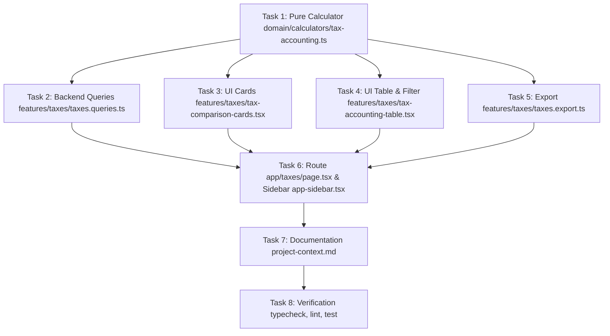

# Modul Perpajakan & Pembukuan Usaha Transportasi PT HW Trans — Implementation Plan

**Tanggal:** 2026-10-15  
**Nomor Sequence:** 28  
**Spesifikasi Desain Acuan:** `docs/specs/2026-10-14-tax-accounting-design.md`  
**Konteks Bisnis:** PT Hadya Wiran Trans (HW Trans)  
**Status:** Ready for Execution  

---

## Ringkasan Eksekutif & Tujuan

Fitur ini mengimplementasikan modul **Perpajakan & Pembukuan Usaha Transportasi** (`/taxes`) untuk armada truk tangki tronton Hi-Blow PT HW Trans. Modul ini menyajikan laporan pembukuan fiskal laba rugi usaha transportasi berstandar akuntansi operasional riil serta membandingkan **3 skema komparasi perhitungan perpajakan resmi Indonesia** secara berdampingan:
1. **Skema 1: PPh Final UMKM 0.5% (PP 55/2022)** dari Total Omset Bruto setahun/sebulan.
2. **Skema 2: Norma Penghitungan Penghasilan Neto (NPPN 29% + PPh Fasilitas 11%)** setelah dikurangi Kredit Pajak PPh 1% terpotong.
3. **Skema 3: Pembukuan Riil Usaha Transportasi (Laba Bersih Riil + PPh Fasilitas 11%)** setelah koreksi penurunan omset 12.5% dan beban operasional riil, dikurangi Kredit Pajak PPh 1%.

Sistem menyediakan **Rekomendasi Pintar (*Smart Recommendation*)** skema paling hemat kas, rekapitulasi kredit pajak PPh 1%, cetak laporan resmi PDF, dan ekspor lembar kerja Excel (`.xlsx`).

---

## Acceptance Criteria Global
- [x] Tersedia pure calculator di `domain/calculators/tax-accounting.ts` dengan 100% test coverage untuk ketiga skema pajak, omset neto 12.5%, dan smart recommendation.
- [x] Tersedia backend query di `features/taxes/taxes.queries.ts` yang mengagregasikan data dari tabel `trips` dan `expenses` (mengecualikan kategori belanja modal `'DP/Cicilan'`).
- [x] Tersedia komponen UI komparasi 3 skema pajak (`tax-comparison-cards.tsx`), rekapitulasi kredit PPh 1% (`tax-withholding-card.tsx`), dan tabel pembukuan fiskal (`tax-accounting-table.tsx`).
- [x] Tersedia filter periode interaktif tahun & bulan (`taxes-filter-bar.tsx`) serta tombol cetak dan ekspor Excel (`taxes.export.ts`).
- [x] Tersedia route `/taxes` di App Router dengan navigasi terintegrasi di `components/layout/app-sidebar.tsx`.
- [x] Seluruh copywriting antarmuka pengguna mematuhi 100% Bahasa Indonesia baku murni.
- [x] Seluruh pengujian otomatis lulus (`pnpm test`), typecheck bersih (`pnpm typecheck`), dan linting bersih (`pnpm lint`).

---

## Gap Analysis (Requirements Mapping)

| Noun / Data Entity | Source / Aturan Bisnis | Mapping Task |
| :--- | :--- | :--- |
| `grossOmset` ($\text{OB}$) | $\sum \text{trips.omset}$ | Task 1, Task 2 |
| `revenueReduction` ($\text{PO}$) | $\operatorname{ROUND}(\text{OB} \times 0.125, 2)$ | Task 1, Task 2, Task 4 |
| `netOmset` ($\text{ON}$) | $\text{OB} - \text{PO}$ | Task 1, Task 4 |
| `driverSangu` ($\text{SS}$) | $\sum \text{trips.sangu}$ | Task 1, Task 2, Task 4 |
| `driverIncentive` ($\text{IS}$) | $\sum \text{trips.incentivePaid}$ | Task 1, Task 2, Task 4 |
| `thirdPartyFee` ($\text{FD}$) | $\sum \text{trips.thirdPartyFee}$ | Task 1, Task 2, Task 4 |
| `factoryDeductions` ($\text{PP}$) | $\sum (\text{trips.deduction2PctLju} + \text{trips.tax1Pct})$ | Task 1, Task 2, Task 4 |
| `truckOpex` ($\text{BO}$) | $\sum (\text{expenses.amount} + \text{expenses.adminFee})$ non-DP/Cicilan | Task 1, Task 2, Task 4 |
| `tax1PctWithholding` ($\text{KP}$) | $\sum \text{trips.tax1Pct}$ pabrik semen non-Grobogan | Task 1, Task 2, Task 3, Task 4 |
| `Scheme 1 (UMKM 0.5%)` | Tarif 0.5% $\times$ Omset Bruto, tanpa kredit pajak | Task 1, Task 3, Task 4, Task 5 |
| `Scheme 2 (Norma 29% x 11%)` | DPP = Omset $\times$ 29%, Pajak = DPP $\times$ 11% - KP | Task 1, Task 3, Task 4, Task 5 |
| `Scheme 3 (Riil 11%)` | DPP = $\max(0, \text{ON} - \text{Beban Riil})$, Pajak = DPP $\times$ 11% - KP | Task 1, Task 3, Task 4, Task 5 |
| `Smart Recommendation` | Perbandingan beban kas terkecil & nominal penghematan | Task 1, Task 3, Task 5 |
| `Excel Export (.xlsx)` | Multi-sheet workbook builder menggunakan `xlsx` | Task 5 |
| `Page & Sidebar Route` | Route `/taxes` dan menu `Perpajakan & Pembukuan` | Task 6 |
| `Project Context Memory` | Pembaruan `.agents/rules/project-context.md` | Task 7 |

---

## Rencana Tugas Atomik (TDD 4-Step Mandatory)



---

### Task 1: [Domain] Pure Calculator Logika Perpajakan & Pembukuan Transportasi

**Files:**
- Create: `domain/calculators/tax-accounting.ts`
- Modify: `domain/calculators/index.ts`
- Test: `domain/calculators/__tests__/tax-accounting.test.ts`

**Requirements:**
- **Acceptance Criteria:**
  1. Menghitung `revenueReduction` sebesar tepat $12.5\%$ dibulatkan 2 desimal dari `grossOmset`, dan `netOmset` $= \text{grossOmset} - \text{revenueReduction}$.
  2. Menghitung `directTripExpenses` (sangu + insentif + fee DO + potongan pabrik), `totalRealExpenses` (+ OPEX truk non-DP/Cicilan), dan `realOperatingProfit` $= \text{netOmset} - \text{totalRealExpenses}$.
  3. Menghitung **Skema 1 (UMKM 0.5%)**: DPP = Omset Bruto, Pajak Bruto = $\operatorname{ROUND}(\text{Omset Bruto} \times 0.005)$, Kredit Pajak = 0, Sisa Setoran = Pajak Bruto, Laba Bersih Setelah Pajak $= \text{realOperatingProfit} - \text{netTaxPayable}$.
  4. Menghitung **Skema 2 (Norma 29% + PPh 11%)**: DPP = $\operatorname{ROUND}(\text{Omset Bruto} \times 0.29)$, Pajak Bruto = $\operatorname{ROUND}(\text{DPP} \times 0.11)$, Kredit Pajak = `tax1PctWithholding`, Sisa Setoran = $\max(0, \text{Pajak Bruto} - \text{Kredit})$, Lebih Bayar = $\max(0, \text{Kredit} - \text{Pajak Bruto})$, Laba Bersih Setelah Pajak $= \text{realOperatingProfit} - \text{Pajak Bruto}$.
  5. Menghitung **Skema 3 (Pembukuan Riil + PPh 11%)**: DPP Fiskal = $\max(0, \text{realOperatingProfit})$, Pajak Bruto = $\operatorname{ROUND}(\text{DPP} \times 0.11)$, Kredit Pajak = `tax1PctWithholding`, Sisa Setoran = $\max(0, \text{Pajak Bruto} - \text{Kredit})$, Lebih Bayar = $\max(0, \text{Kredit} - \text{Pajak Bruto})$, Laba Bersih Setelah Pajak $= \text{realOperatingProfit} - \text{Pajak Bruto}$.
  6. Menghitung **Smart Recommendation**: Menentukan `bestSchemeId` dengan beban kas terendah ($\min(\text{netTaxPayable})$), menghitung `cashSavings` terhadap skema tertinggi, dan memberikan penjelasan deskriptif dalam Bahasa Indonesia.
  7. Menangani skenario batas: omset 0, rugi usaha operasional, dan kredit pajak lebih besar dari pajak terutang.

- **Functional Requirements:**
  - Fungsi murni tanpa efek samping (pure function).
  - Menerima parameter input dengan default rate yang dapat dikustomisasi (`revenueReductionRate = 0.125`, `umkmRate = 0.005`, `normaRate = 0.29`, `corporateTaxRate = 0.11`).

- **Non-Functional Requirements:**
  - Eksekusi deterministik, bebas floating point precision hazard melalui `Math.round(val * 100) / 100`.

- **Test Coverage:**
  - [Unit] Skenario bisnis normal (profitable period dengan omset 100 jt).
  - [Unit] Skenario rugi usaha operasional (beban riil melebihi omset neto).
  - [Unit] Skenario kredit pajak melebihi pajak terutang (kondisi lebih bayar / restitusi).
  - [Unit] Skenario omset 0 atau tanpa transaksi.

**Step 1: Write failing test (RED)**
Tulis file `domain/calculators/__tests__/tax-accounting.test.ts`:
```typescript
import { describe, expect, it } from "vitest"
import { calculateTaxAccounting } from "@/domain/calculators/tax-accounting"

describe("calculateTaxAccounting", () => {
  it("calculates accurate transportation bookkeeping and 3 tax schemes for profitable business", () => {
    // Gross Omset: 100,000,000
    // Revenue Reduction (12.5%): 12,500,000 -> Net Omset: 87,500,000
    // Sangu: 40,000,000, Incentive: 3,500,000, ThirdPartyFee: 1,500,000, FactoryDeduction: 2,000,000
    // Direct Trip Expenses: 47,000,000
    // Truck OPEX: 15,500,000
    // Total Real Expenses: 62,500,000
    // Real Operating Profit: 87,500,000 - 62,500,000 = 25,000,000
    // Tax 1% Withholding Credit: 1,000,000
    const result = calculateTaxAccounting({
      grossOmset: 100000000,
      driverSangu: 40000000,
      driverIncentive: 3500000,
      thirdPartyFee: 1500000,
      factoryDeductions: 2000000,
      truckOpex: 15500000,
      tax1PctWithholding: 1000000,
    })

    // 1. Bookkeeping summary
    expect(result.bookkeeping.grossOmset).toBe(100000000)
    expect(result.bookkeeping.revenueReduction).toBe(12500000)
    expect(result.bookkeeping.netOmset).toBe(87500000)
    expect(result.bookkeeping.directTripExpenses).toBe(47000000)
    expect(result.bookkeeping.truckOpex).toBe(15500000)
    expect(result.bookkeeping.totalRealExpenses).toBe(62500000)
    expect(result.bookkeeping.realOperatingProfit).toBe(25000000)
    expect(result.bookkeeping.tax1PctWithholding).toBe(1000000)

    // 2. Scheme 1: UMKM 0.5%
    // DPP: 100,000,000 * 0.005 = 500,000. No tax credit. Net tax: 500,000.
    const s1 = result.schemes.find((s) => s.schemeId === "umkm_0_5")!
    expect(s1).toBeDefined()
    expect(s1.dpp).toBe(100000000)
    expect(s1.grossTax).toBe(500000)
    expect(s1.taxCredit).toBe(0)
    expect(s1.netTaxPayable).toBe(500000)
    expect(s1.realNetProfitAfterTax).toBe(24500000) // 25,000,000 - 500,000

    // 3. Scheme 2: Norma 29% x 11%
    // DPP: 100,000,000 * 0.29 = 29,000,000
    // Gross Tax: 29,000,000 * 0.11 = 3,190,000
    // Tax Credit: 1,000,000 -> Net Payable: 2,190,000
    const s2 = result.schemes.find((s) => s.schemeId === "norma_29_11")!
    expect(s2).toBeDefined()
    expect(s2.dpp).toBe(29000000)
    expect(s2.grossTax).toBe(3190000)
    expect(s2.taxCredit).toBe(1000000)
    expect(s2.netTaxPayable).toBe(2190000)
    expect(s2.realNetProfitAfterTax).toBe(21810000) // 25,000,000 - 3,190,000

    // 4. Scheme 3: Pembukuan Riil 11%
    // DPP: 25,000,000 (Laba Usaha Riil)
    // Gross Tax: 25,000,000 * 0.11 = 2,750,000
    // Tax Credit: 1,000,000 -> Net Payable: 1,750,000
    const s3 = result.schemes.find((s) => s.schemeId === "real_bookkeeping_11")!
    expect(s3).toBeDefined()
    expect(s3.dpp).toBe(25000000)
    expect(s3.grossTax).toBe(2750000)
    expect(s3.taxCredit).toBe(1000000)
    expect(s3.netTaxPayable).toBe(1750000)
    expect(s3.realNetProfitAfterTax).toBe(22250000) // 25,000,000 - 2,750,000

    // 5. Smart recommendation: UMKM 0.5% (setoran 500rb vs 1.75jt vs 2.19jt)
    expect(result.recommendation.bestSchemeId).toBe("umkm_0_5")
    expect(result.recommendation.cashSavings).toBe(1690000) // 2,190,000 - 500,000
  })

  it("recommends real bookkeeping when business is operating at a loss", () => {
    // Gross Omset: 50,000,000 -> Net Omset: 43,750,000
    // Total Real Expenses: 55,000,000 -> Real Loss: -11,250,000
    // Tax 1% Withholding Credit: 500,000
    const result = calculateTaxAccounting({
      grossOmset: 50000000,
      driverSangu: 30000000,
      driverIncentive: 2000000,
      thirdPartyFee: 1000000,
      factoryDeductions: 1000000,
      truckOpex: 21000000,
      tax1PctWithholding: 500000,
    })

    expect(result.bookkeeping.realOperatingProfit).toBe(-11250000)

    // UMKM 0.5% still pays 250,000 (final tax ignores loss)
    const s1 = result.schemes.find((s) => s.schemeId === "umkm_0_5")!
    expect(s1.netTaxPayable).toBe(250000)

    // Real bookkeeping has 0 tax and 500,000 tax overpayment (lebih bayar)
    const s3 = result.schemes.find((s) => s.schemeId === "real_bookkeeping_11")!
    expect(s3.dpp).toBe(0)
    expect(s3.grossTax).toBe(0)
    expect(s3.netTaxPayable).toBe(0)
    expect(s3.taxOverpayment).toBe(500000)

    expect(result.recommendation.bestSchemeId).toBe("real_bookkeeping_11")
  })
})
```

**Step 2: Verify test fails**
Run: `pnpm test domain/calculators/__tests__/tax-accounting.test.ts`  
Expected: FAIL with `Cannot find module '@/domain/calculators/tax-accounting'`.

**Step 3: Write minimal implementation (GREEN)**
Tulis file `domain/calculators/tax-accounting.ts`:
```typescript
export type TaxSchemeId = "umkm_0_5" | "norma_29_11" | "real_bookkeeping_11"

export interface TaxAccountingInput {
  grossOmset: number
  driverSangu: number
  driverIncentive: number
  thirdPartyFee: number
  factoryDeductions: number
  truckOpex: number
  tax1PctWithholding: number
  revenueReductionRate?: number
  umkmRate?: number
  normaRate?: number
  corporateTaxRate?: number
}

export interface TaxBookkeepingSummary {
  grossOmset: number
  revenueReductionRate: number
  revenueReduction: number
  netOmset: number
  driverSangu: number
  driverIncentive: number
  thirdPartyFee: number
  factoryDeductions: number
  directTripExpenses: number
  truckOpex: number
  totalRealExpenses: number
  realOperatingProfit: number
  tax1PctWithholding: number
}

export interface TaxSchemeCalculation {
  schemeId: TaxSchemeId
  schemeName: string
  description: string
  dpp: number
  rateDisplay: string
  grossTax: number
  taxCredit: number
  netTaxPayable: number
  taxOverpayment: number
  realNetProfitAfterTax: number
  cashBurden: number
  isRecommended: boolean
}

export interface TaxRecommendation {
  bestSchemeId: TaxSchemeId
  bestSchemeName: string
  cashSavings: number
  explanation: string
}

export interface TaxAccountingResult {
  bookkeeping: TaxBookkeepingSummary
  schemes: TaxSchemeCalculation[]
  recommendation: TaxRecommendation
}

export function calculateTaxAccounting(
  input: TaxAccountingInput
): TaxAccountingResult {
  const {
    grossOmset,
    driverSangu,
    driverIncentive,
    thirdPartyFee,
    factoryDeductions,
    truckOpex,
    tax1PctWithholding,
    revenueReductionRate = 0.125,
    umkmRate = 0.005,
    normaRate = 0.29,
    corporateTaxRate = 0.11,
  } = input

  const revenueReduction = Math.round(grossOmset * revenueReductionRate * 100) / 100
  const netOmset = Math.round((grossOmset - revenueReduction) * 100) / 100
  const directTripExpenses =
    Math.round((driverSangu + driverIncentive + thirdPartyFee + factoryDeductions) * 100) / 100
  const totalRealExpenses =
    Math.round((directTripExpenses + truckOpex) * 100) / 100
  const realOperatingProfit =
    Math.round((netOmset - totalRealExpenses) * 100) / 100

  // 1. Skema 1: PPh Final UMKM 0.5% (PP 55/2022)
  const s1Dpp = grossOmset
  const s1GrossTax = Math.round(s1Dpp * umkmRate)
  const s1TaxCredit = 0
  const s1NetTaxPayable = s1GrossTax
  const s1TaxOverpayment = 0
  const s1ProfitAfterTax = realOperatingProfit - s1NetTaxPayable
  const s1CashBurden = s1NetTaxPayable

  // 2. Skema 2: Norma Penghitungan (NPPN 29% + PPh 11%)
  const s2Dpp = Math.round(grossOmset * normaRate)
  const s2GrossTax = Math.round(s2Dpp * corporateTaxRate)
  const s2TaxCredit = tax1PctWithholding
  const s2NetTaxPayable = Math.max(0, s2GrossTax - s2TaxCredit)
  const s2TaxOverpayment = s2GrossTax < s2TaxCredit ? s2TaxCredit - s2GrossTax : 0
  const s2ProfitAfterTax = realOperatingProfit - s2GrossTax
  const s2CashBurden = s2NetTaxPayable

  // 3. Skema 3: Pembukuan Riil (Laba Bersih Riil + PPh 11%)
  const s3Dpp = Math.max(0, realOperatingProfit)
  const s3GrossTax = Math.round(s3Dpp * corporateTaxRate)
  const s3TaxCredit = tax1PctWithholding
  const s3NetTaxPayable = Math.max(0, s3GrossTax - s3TaxCredit)
  const s3TaxOverpayment = s3GrossTax < s3TaxCredit ? s3TaxCredit - s3GrossTax : 0
  const s3ProfitAfterTax = realOperatingProfit - s3GrossTax
  const s3CashBurden = s3NetTaxPayable

  // Smart Recommendation
  const schemesRaw = [
    {
      schemeId: "umkm_0_5" as const,
      schemeName: "PPh Final UMKM 0.5% (PP 55/2022)",
      description: "Tarif 0.5% dari Omset Bruto tanpa memperhitungkan beban dan kredit pajak.",
      dpp: s1Dpp,
      rateDisplay: "0.5% Final",
      grossTax: s1GrossTax,
      taxCredit: s1TaxCredit,
      netTaxPayable: s1NetTaxPayable,
      taxOverpayment: s1TaxOverpayment,
      realNetProfitAfterTax: s1ProfitAfterTax,
      cashBurden: s1CashBurden,
    },
    {
      schemeId: "norma_29_11" as const,
      schemeName: "Norma Penghitungan (NPPN 29% + PPh 11%)",
      description: "Penghasilan neto ditaksir 29% dari omset, dikenakan tarif fasilitas 11%, dikurangi kredit PPh 1%.",
      dpp: s2Dpp,
      rateDisplay: "Norma 29% × 11%",
      grossTax: s2GrossTax,
      taxCredit: s2TaxCredit,
      netTaxPayable: s2NetTaxPayable,
      taxOverpayment: s2TaxOverpayment,
      realNetProfitAfterTax: s2ProfitAfterTax,
      cashBurden: s2CashBurden,
    },
    {
      schemeId: "real_bookkeeping_11" as const,
      schemeName: "Pembukuan Riil (Laba Bersih + PPh 11%)",
      description: "Laba bersih operasional riil setelah koreksi omset 12.5% dan beban riil, dikurangi kredit PPh 1%.",
      dpp: s3Dpp,
      rateDisplay: "Laba Riil × 11%",
      grossTax: s3GrossTax,
      taxCredit: s3TaxCredit,
      netTaxPayable: s3NetTaxPayable,
      taxOverpayment: s3TaxOverpayment,
      realNetProfitAfterTax: s3ProfitAfterTax,
      cashBurden: s3CashBurden,
    },
  ]

  let bestIndex = 0
  let minBurden = schemesRaw[0].cashBurden
  let maxBurden = schemesRaw[0].cashBurden

  for (let i = 1; i < schemesRaw.length; i++) {
    const burden = schemesRaw[i].cashBurden
    if (burden < minBurden) {
      minBurden = burden
      bestIndex = i
    }
    if (burden > maxBurden) {
      maxBurden = burden
    }
  }

  const bestScheme = schemesRaw[bestIndex]
  const cashSavings = maxBurden - minBurden

  const schemes: TaxSchemeCalculation[] = schemesRaw.map((s, idx) => ({
    ...s,
    isRecommended: idx === bestIndex,
  }))

  const explanation =
    cashSavings > 0
      ? `Skema ${bestScheme.schemeName} menghasilkan setoran kas paling hemat sebesar Rp ${minBurden.toLocaleString("id-ID")}, memberikan penghematan kas kas hingga Rp ${cashSavings.toLocaleString("id-ID")} dibandingkan opsi lainnya.`
      : `Seluruh skema menghasilkan kewajiban kas yang seimbang pada periode ini.`

  return {
    bookkeeping: {
      grossOmset,
      revenueReductionRate,
      revenueReduction,
      netOmset,
      driverSangu,
      driverIncentive,
      thirdPartyFee,
      factoryDeductions,
      directTripExpenses,
      truckOpex,
      totalRealExpenses,
      realOperatingProfit,
      tax1PctWithholding,
    },
    schemes,
    recommendation: {
      bestSchemeId: bestScheme.schemeId,
      bestSchemeName: bestScheme.schemeName,
      cashSavings,
      explanation,
    },
  }
}
```

Ekspor di `domain/calculators/index.ts`:
```typescript
export * from "./tax-accounting"
```

**Step 4: Verify test passes & Refactor**
Run: `pnpm test domain/calculators/__tests__/tax-accounting.test.ts`  
Expected: PASS with 100% assertions succeeded.

---

### Task 2: [Backend/Queries] Query Agregasi Data Pembukuan Fiskal Usaha Transportasi

**Files:**
- Create: `features/taxes/taxes.queries.ts`
- Test: `features/taxes/__tests__/taxes-queries.test.ts`

**Requirements:**
- **Acceptance Criteria:**
  1. `getTaxAccountingData(filter)` menerima parameter `year: number`, optional `month?: number`, dan optional `truckId?: string`.
  2. Mengagregasi data dari tabel `trips`:
     - Filter `unloadingDate` berdasarkan `year` dan `month` (jika diberikan). Jika `month` kosong, mengagregasikan seluruh tahun (1-12).
     - Mengagregasi `omset`, `sangu`, `incentivePaid`, `thirdPartyFee`, `deduction2PctLju`, `tax1Pct`.
     - Menghitung total ritase (`totalTrips`) dan total tonase terkirim (`totalTonnage`).
  3. Mengagregasi data dari tabel `expenses`:
     - Filter `expenseDate` berdasarkan periode yang sama.
     - Mengecualikan kategori `'DP/Cicilan'` (`category != 'DP/Cicilan'`).
     - Mengagregasikan `amount + adminFee`.
     - Mengembalikan breakdown biaya operasional per kategori (`categoryBreakdown`).
  4. Meneruskan seluruh metrik ke `calculateTaxAccounting()` dan mengembalikan objek terpadu `TaxAccountingData`.

- **Functional Requirements:**
  - Mendukung penanganan data kosong (*graceful empty state*) saat belum ada ritase/pengeluaran pada periode tertentu dengan nilai 0.

- **Non-Functional Requirements:**
  - Optimalisasi query Drizzle menggunakan agregasi SQL terkompilasi (`sum`, `coalesce`, `count`) agar performa respons < 100ms.

- **Test Coverage:**
  - [Integration/Unit] `getTaxAccountingData` dengan filter tahunan penuh.
  - [Integration/Unit] `getTaxAccountingData` dengan filter spesifik bulan dan filter armada truk.
  - [Integration/Unit] Memastikan kategori pengeluaran `'DP/Cicilan'` diabaikan dari perhitungan OPEX pajak.

**Step 1: Write failing test (RED)**
Tulis file `features/taxes/__tests__/taxes-queries.test.ts` (menguji integrasi agregasi dan pengecualian DP/Cicilan).

**Step 2: Verify test fails**
Run: `pnpm test features/taxes/__tests__/taxes-queries.test.ts`  
Expected: FAIL with module not found.

**Step 3: Write minimal implementation (GREEN)**
Tulis file `features/taxes/taxes.queries.ts` dengan query SQL Drizzle aggregations untuk `trips` dan `expenses`.

**Step 4: Verify test passes & Refactor**
Run: `pnpm test features/taxes/__tests__/taxes-queries.test.ts`  
Expected: PASS with exit code 0.

---

### Task 3: [UI] Komponen Kartu Komparasi 3 Skema Pajak & Rekapitulasi Kredit PPh 1%

**Files:**
- Create: `features/taxes/tax-comparison-cards.tsx`
- Create: `features/taxes/tax-withholding-card.tsx`
- Test: `features/taxes/__tests__/tax-comparison-cards.test.tsx`

**Requirements:**
- **Acceptance Criteria:**
  1. `tax-comparison-cards.tsx` merender 3 kartu grid responsive (1 kolom mobile, 3 kolom desktop):
     - **Kartu 1 (UMKM 0.5%)**: Label "Skema A: PPh Final UMKM 0.5%", DPP Omset Bruto, Tarif 0.5%, Pajak Terutang, Status Efisiensi.
     - **Kartu 2 (Norma 29% x 11%)**: Label "Skema B: Norma (NPPN 29% + PPh 11%)", DPP Norma (29% Omset), Tarif 11%, Pajak Bruto, Kredit Pajak PPh 1%, Sisa Setoran Kas.
     - **Kartu 3 (Pembukuan Riil 11%)**: Label "Skema C: Pembukuan Riil Usaha", DPP Laba Usaha Riil, Tarif 11%, Pajak Bruto, Kredit Pajak PPh 1%, Sisa Setoran Kas.
  2. Kartu yang direkomendasikan memiliki border beraksen emerald, badge *"Paling Hemat Kas"*, serta status visual yang tegas.
  3. Menampilkan banner rekomendasi pintar (*Smart Recommendation*) di atas kartu yang menerangkan nominal penghematan kas riil secara gamblang.
  4. `tax-withholding-card.tsx` merender ringkasan kredit pajak PPh 1% yang telah dipotong langsung oleh pabrik semen non-Grobogan (SI Tuban, SI Rembang, SBI Tuban), dengan penjelasan bahwa bukti potong ini sah mengurangi setoran PPh pada Skema 2 dan Skema 3.
  5. Seluruh label dan angka diformat dengan format mata uang Rupiah Indonesia (`Rp xx.xxx.xxx`) dan 100% Bahasa Indonesia baku.

- **Test Coverage:**
  - [Unit] Rendering ketiga kartu dengan data finansial yang akurat.
  - [Unit] Badge "Paling Hemat Kas" terpasang tepat pada skema pemenang.
  - [Unit] Menampilkan nominal sisa setoran dan lebih bayar secara benar.

**Step 1: Write failing test (RED)**
Tulis file `features/taxes/__tests__/tax-comparison-cards.test.tsx`.

**Step 2: Verify test fails**
Run: `pnpm test features/taxes/__tests__/tax-comparison-cards.test.tsx`  
Expected: FAIL.

**Step 3: Write minimal implementation (GREEN)**
Tulis `features/taxes/tax-comparison-cards.tsx` dan `features/taxes/tax-withholding-card.tsx`.

**Step 4: Verify test passes & Refactor**
Run: `pnpm test features/taxes/__tests__/tax-comparison-cards.test.tsx`  
Expected: PASS.

---

### Task 4: [UI] Komponen Tabel Laporan Pembukuan Fiskal Usaha Transportasi & Filter Bar

**Files:**
- Create: `features/taxes/tax-accounting-table.tsx`
- Create: `features/taxes/taxes-filter-bar.tsx`
- Test: `features/taxes/__tests__/tax-accounting-table.test.tsx`

**Requirements:**
- **Acceptance Criteria:**
  1. `tax-accounting-table.tsx` menyajikan format pembukuan usaha transportasi resmi yang rapi dan terbagi menjadi 5 Bagian Terstruktur:
     - **Bagian I: Pendapatan Usaha Transportasi** (Omset Bruto Ritase, Koreksi Penurunan Omset 12.5%, Omset Neto Usaha).
     - **Bagian II: Beban Langsung Ritase (COGS / Direct Costs)** (Sangu Supir All-In, Insentif Ritase Supir, Fee DO Pihak Ketiga, Potongan Pabrik).
     - **Bagian III: Beban Operasional Armada (OPEX)** (Rincian per kategori pengeluaran: Servis & Perbaikan, Onderdil/Ban, Administrasi/KIR/STNK, dll.).
     - **Bagian IV: Laba Usaha Riil Sebelum Pajak (EBT)**.
     - **Bagian V: Evaluasi Pajak & Laba Bersih Setelah Pajak (EAT)** untuk masing-masing skema (UMKM 0.5%, Norma 29%, dan Pembukuan Riil 11%).
  2. `taxes-filter-bar.tsx` menyediakan kontrol filter:
     - Pilihan Tahun (Tahun berjalan dan tahun sebelumnya).
     - Pilihan Bulan (Januari s.d. Desember, serta opsi "Rekapitulasi Seluruh Tahun").
     - Pilihan Armada Truk ("Semua Unit", "W 8187 UA", "H 8133 OF").
     - Tombol Aksi: *"Cetak Laporan"* (`window.print()`) dan *"Ekspor Excel"* (`.xlsx`).
  3. Responsif di mobile, tablet, dan desktop; serta ramah cetak (*print-friendly stylesheet*).

- **Test Coverage:**
  - [Unit] Rendering seluruh pos pembukuan fiskal dengan nilai kalkulasi yang sinkron.
  - [Unit] Filter bar memperbarui URL query params dengan tepat.

**Step 1: Write failing test (RED)**
Tulis `features/taxes/__tests__/tax-accounting-table.test.tsx`.

**Step 2: Verify test fails**
Run: `pnpm test features/taxes/__tests__/tax-accounting-table.test.tsx`  
Expected: FAIL.

**Step 3: Write minimal implementation (GREEN)**
Tulis `features/taxes/tax-accounting-table.tsx` dan `features/taxes/taxes-filter-bar.tsx`.

**Step 4: Verify test passes & Refactor**
Run: `pnpm test features/taxes/__tests__/tax-accounting-table.test.tsx`  
Expected: PASS.

---

### Task 5: [Export] Generator Ekspor Excel Laporan Pembukuan & Komparasi Pajak

**Files:**
- Create: `features/taxes/taxes.export.ts`
- Test: `features/taxes/__tests__/taxes-export.test.ts`

**Requirements:**
- **Acceptance Criteria:**
  1. Fungsi `formatTaxAccountingForExcel(data: TaxAccountingData): ExcelSheetData[]` menghasilkan 3 lembar kerja (sheets) terstruktur:
     - **Sheet 1: Komparasi Skema Pajak**: Membandingkan Skema 1, 2, dan 3 (DPP, Tarif, Pajak Bruto, Kredit PPh 1%, Sisa Setoran Kas, Laba Setelah Pajak, dan Skema Rekomendasi).
     - **Sheet 2: Pembukuan Fiskal Usaha**: Menyajikan pos-pos pembukuan fiskal (Pendapatan Bruto, Penurunan Omset 12.5%, Omset Neto, Beban Ritase Langsung, Beban OPEX Truk, Laba Usaha Riil).
     - **Sheet 3: Rekap Kredit PPh 1%**: Rincian potongan PPh 1% per ritase/pabrik non-Grobogan sebagai lampiran bukti potong.
  2. Menggunakan `buildExcelWorkbookBlob()` dari `lib/export/excel-builder.ts`.
  3. Memastikan penamaan file ekspor bersih: `Laporan_Perpajakan_HW_Trans_[Periode].xlsx`.

- **Test Coverage:**
  - [Unit] `formatTaxAccountingForExcel` menghasilkan 3 sheet dengan header dan baris data yang lengkap.
  - [Unit] Angka dan formula pada sheet Excel sesuai dengan perhitungan domain calculator.

**Step 1: Write failing test (RED)**
Tulis `features/taxes/__tests__/taxes-export.test.ts`.

**Step 2: Verify test fails**
Run: `pnpm test features/taxes/__tests__/taxes-export.test.ts`  
Expected: FAIL.

**Step 3: Write minimal implementation (GREEN)**
Tulis `features/taxes/taxes.export.ts`.

**Step 4: Verify test passes & Refactor**
Run: `pnpm test features/taxes/__tests__/taxes-export.test.ts`  
Expected: PASS.

---

### Task 6: [Routing & Sidebar] Halaman Dasbor Perpajakan & Integrasi Navigasi Sidebar

**Files:**
- Create: `app/(dashboard)/taxes/page.tsx`
- Modify: `components/layout/app-sidebar.tsx:37-64`
- Test: `features/taxes/__tests__/taxes-page.test.tsx`

**Requirements:**
- **Acceptance Criteria:**
  1. Halaman `/taxes` adalah Server Component yang membaca `searchParams` (`year`, `month`, `truckId`).
  2. Mengambil data dari `getTaxAccountingData()` dan merender seluruh komponen:
     - `TaxesFilterBar`
     - `TaxComparisonCards`
     - `TaxWithholdingCard`
     - `TaxAccountingTable`
  3. Menambahkan item navigasi *"Perpajakan & Pembukuan"* dengan tautan `/taxes` di `data.navMain` pada `components/layout/app-sidebar.tsx`, menggunakan ikon `@remixicon/react` (`RiPercentLine` atau `RiCalculatorLine`).
  4. Seluruh copywriting 100% Bahasa Indonesia baku.

- **Test Coverage:**
  - [Unit/Integration] Mengetes rendering halaman `/taxes` dengan parameter default (tahun berjalan).
  - [Unit] Memverifikasi kehadiran link `/taxes` pada data navigasi sidebar.

**Step 1: Write failing test (RED)**
Tulis `features/taxes/__tests__/taxes-page.test.tsx`.

**Step 2: Verify test fails**
Run: `pnpm test features/taxes/__tests__/taxes-page.test.tsx`  
Expected: FAIL.

**Step 3: Write minimal implementation (GREEN)**
Tulis `app/(dashboard)/taxes/page.tsx` dan perbarui `components/layout/app-sidebar.tsx`.

**Step 4: Verify test passes & Refactor**
Run: `pnpm test features/taxes/__tests__/taxes-page.test.tsx`  
Expected: PASS.

---

### Task 7: [Documentation & Project Context] Pembaruan Context Memory

**Files:**
- Modify: `.agents/rules/project-context.md`

**Requirements:**
- **Acceptance Criteria:**
  1. Memperbarui Seksi 1 (Ringkasan Proyek & Persona Pengguna): mencatat modul `/taxes` untuk analisis perpajakan dan pembukuan fiskal.
  2. Memperbarui Seksi 3 (Arsitektur Kode & Pola Direktori): mencatat `features/taxes/` dan `domain/calculators/tax-accounting.ts`.
  3. Memperbarui Seksi 4 (Aturan Bisnis & Formula Finansial): mencatat aturan 3 skema perpajakan (UMKM 0.5%, NPPN 29% + PPh 11%, Pembukuan Riil 11%), formula penurunan omset 12.5%, dan pemanfaatan kredit pajak PPh 1% non-Grobogan.

**Step 1: Write updates to project-context.md**
Perbarui `.agents/rules/project-context.md`.

**Step 2: Verify diff integrity**
Periksa kebersihan dokumen.

---

### Task 8: [Verification] Verifikasi Komprehensif Seluruh Sistem

**Files:**
- N/A (Full verification run)

**Requirements:**
- **Acceptance Criteria:**
  1. `pnpm typecheck` lulus 0 errors.
  2. `pnpm lint` lulus 0 warnings/errors.
  3. `pnpm test` menjalankan seluruh test suites (termasuk modul baru) dengan 100% lulus.
  4. `pnpm format` memastikan kepatuhan gaya kode Prettier.

**Execution Commands:**
1. `pnpm typecheck`
2. `pnpm lint`
3. `pnpm test`
4. `pnpm format`

---

## Ringkasan Eksekusi & Checkpoints

| Task | Komponen | Estimasi | Ketergantungan |
| :--- | :--- | :--- | :--- |
| **Task 1** | Pure Domain Calculator `tax-accounting.ts` | 5 menit | - |
| **Task 2** | Backend Queries `taxes.queries.ts` | 5 menit | Task 1 |
| **Task 3** | UI Cards `tax-comparison-cards.tsx` & `tax-withholding-card.tsx` | 5 menit | Task 1 |
| **Task 4** | UI Table & Filter `tax-accounting-table.tsx` & `taxes-filter-bar.tsx` | 5 menit | Task 1, Task 2 |
| **Task 5** | Export Module `taxes.export.ts` | 4 menit | Task 1 |
| **Task 6** | Page `/taxes` & Sidebar Navigation | 4 menit | Task 2, 3, 4, 5 |
| **Task 7** | Context Memory `project-context.md` | 3 menit | Task 6 |
| **Task 8** | Full System Verification (typecheck, lint, test) | 3 menit | Task 1 s.d. 7 |
