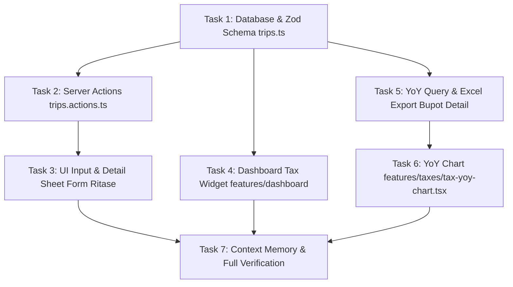

# Peningkatan Terpadu Modul Perpajakan & Operasional Armada PT HW Trans — Implementation Plan

**Tanggal:** 2026-10-15  
**Nomor Sequence:** 29  
**Spesifikasi Desain Acuan:** `docs/specs/2026-10-15-tax-enhancements-design.md`  
**Konteks Bisnis:** PT Hadya Wiran Trans (HW Trans)  
**Status:** Ready for Execution  

---

## Ringkasan Eksekutif & Tujuan

Fitur ini mengimplementasikan **Paket Peningkatan Bernilai Tambah Tinggi** pada modul perpajakan dan operasional armada truk tronton Hi-Blow PT HW Trans:
1. **Widget Estimasi Pajak di Dasbor Utama (`/dashboard`)**: Kartu sorotan finansial tepat di bawah 4 KPI Cards yang menampilkan posisi beban kas pajak tahun berjalan, peredaran bruto, rekomendasi skema terhemat, dan tombol pintas ke `/taxes`.
2. **Pencatatan Nomor & Tanggal Bukti Potong PPh 1% per Ritase (`/trips`)**: Kolom baru opsional `taxWithholdingNumber` dan `taxWithholdingDate` pada tabel `trips`, form ritase kondisional (khusus pabrik semen non-Grobogan), tampilan detail sheet, dan lampiran ekspor Excel.
3. **Grafik Tren Pembukuan Antar-Tahun (*Year-over-Year*) di `/taxes`**: Grafik interaktif Recharts komparasi multi-tahun (2024, 2025, 2026) yang menyandingkan Omset Bruto, Omset Neto (setelah 12.5%), Beban Riil, Laba Usaha Riil, dan Beban Pajak Setoran Kas.

---

## Acceptance Criteria Global
- [x] Tersedia migrasi Drizzle untuk 2 kolom baru pada tabel `trips`: `taxWithholdingNumber` (`varchar(100)`) dan `taxWithholdingDate` (`date`).
- [x] Schema Zod `trips.schema.ts` dan Server Actions `createTrip` & `updateTrip` mendukung kedua field bupot opsional tersebut.
- [x] Form ritase (`trip-form-dialog.tsx`) menampilkan seksi input nomor & tanggal bupot secara kondisional (khusus rute pabrik non-Grobogan).
- [x] Sheet detail ritase (`trip-detail-sheet.tsx`) dan tabel ritase (`trips-table.tsx`) menampilkan informasi bukti potong jika telah diisi.
- [x] Tersedia komponen `DashboardTaxWidget` di `/dashboard` di bawah 4 KPI cards dengan metrik finansial tahun berjalan.
- [x] Tersedia query `getTaxYoyData([2024, 2025, 2026])` dan komponen visual `TaxYoyChart` di halaman `/taxes`.
- [x] Ekspor Excel (`taxes.export.ts`) Sheet 3 mencantumkan rincian nomor dan tanggal bukti potong per transaksi ritase.
- [x] Seluruh copywriting UI 100% Bahasa Indonesia baku murni.
- [x] Seluruh pengujian otomatis lulus (`pnpm test`), typecheck bersih (`pnpm typecheck`), dan linting bersih (`pnpm lint`).

---

## Gap Analysis (Requirements Mapping)

| Noun / Data Entity | Source / Aturan Bisnis | Mapping Task |
| :--- | :--- | :--- |
| `taxWithholdingNumber` | Nomor Bupot PPh 23 / Faktur Pajak dari pabrik semen non-Grobogan | Task 1, Task 2, Task 3, Task 5 |
| `taxWithholdingDate` | Tanggal penerbitan dokumen bukti potong | Task 1, Task 2, Task 3, Task 5 |
| `DashboardTaxWidget` | Kartu sorotan estimasi posisi pajak tahun berjalan di `/dashboard` | Task 4 |
| `getTaxYoyData` | Agregasi finansial komparatif multi-tahun (2024 s.d. 2026) | Task 5 |
| `TaxYoyChart` | Grafik batang/area interaktif Recharts tren multi-tahun di `/taxes` | Task 6 |
| `Sheet 3 Bupot Detail` | Rincian transaksi bupot per ritase pada file Excel `.xlsx` | Task 5 |
| `Project Context Memory` | Pembaruan `.agents/rules/project-context.md` | Task 7 |

---

## Rencana Tugas Atomik (TDD 4-Step Mandatory)



---

### Task 1: [Database & Schema] Migrasi Kolom Bukti Potong PPh 1% pada `trips` dan Schema Zod

**Files:**
- Modify: `db/schema/trips.ts`
- Modify: `features/trips/trips.schema.ts`
- Test: `features/trips/__tests__/trips-schema.test.ts`

**Requirements:**
- **Acceptance Criteria:**
  1. Menambahkan kolom `taxWithholdingNumber` (`varchar("tax_withholding_number", { length: 100 })`) dan `taxWithholdingDate` (`date("tax_withholding_date")`) pada tabel `trips`.
  2. Memperbarui skema Zod `tripFormSchema` di `features/trips/trips.schema.ts` untuk menerima `taxWithholdingNumber` (string maks 100 karakter, opsional/nullable) dan `taxWithholdingDate` (string format YYYY-MM-DD, opsional/nullable).
  3. Memastikan nilai string kosong `""` ditransformasikan secara aman menjadi `null` atau `undefined` agar tidak menyimpan string kosong ke kolom date/varchar.

- **Functional Requirements:**
  - Kompatibel dengan Drizzle ORM tanpa merusak backward compatibility data transaksi yang sudah ada.

- **Non-Functional Requirements:**
  - Tipe TypeScript diekspor secara konsisten melalui `Trip` dan `TripFormData`.

- **Test Coverage:**
  - [Unit] `tripFormSchema.safeParse()` dengan nomor dan tanggal bupot valid.
  - [Unit] `tripFormSchema.safeParse()` dengan nilai kosong/null (opsionalitas terjamin).
  - [Unit] Validasi error jika format tanggal bukan YYYY-MM-DD.

**Step 1: Write failing test (RED)**
Perbarui `features/trips/__tests__/trips-schema.test.ts`:
```typescript
it("validates optional tax withholding number and date correctly", () => {
  const validData = {
    // ... payload ritase standar ...
    taxWithholdingNumber: "BP-SI-2026-00123",
    taxWithholdingDate: "2026-10-14",
  }
  const result = tripFormSchema.safeParse(validData)
  expect(result.success).toBe(true)
})
```

**Step 2: Verify test fails**
Run: `pnpm test features/trips/__tests__/trips-schema.test.ts`  
Expected: FAIL if schema hasn't recognized the new fields.

**Step 3: Write minimal implementation (GREEN)**
Perbarui `db/schema/trips.ts` dan `features/trips/trips.schema.ts`.

**Step 4: Verify test passes & Refactor**
Run: `pnpm test features/trips/__tests__/trips-schema.test.ts`  
Expected: PASS.

---

### Task 2: [Backend/Trips Actions] Integrasi Penyimpanan Bukti Potong di Server Actions Ritase

**Files:**
- Modify: `features/trips/trips.actions.ts`
- Test: `features/trips/__tests__/trips-fee-actions.test.ts` (atau co-located actions test)

**Requirements:**
- **Acceptance Criteria:**
  1. `createTrip` memetakan `taxWithholdingNumber` dan `taxWithholdingDate` dari input form ke kolom database `trips`.
  2. `updateTrip` dapat memperbarui atau mengosongkan nomor dan tanggal bukti potong.
  3. Mengembalikan pesan sukses dalam Bahasa Indonesia baku.

- **Test Coverage:**
  - [Unit/Integration] `createTrip` menyimpan data bukti potong.
  - [Unit/Integration] `updateTrip` memperbarui data bukti potong yang sudah ada.

**Step 1: Write failing test (RED)**
Tulis skenario pengujian di `features/trips/__tests__/trips-fee-actions.test.ts`.

**Step 2: Verify test fails**
Run: `pnpm test features/trips/__tests__/trips-fee-actions.test.ts`  
Expected: FAIL.

**Step 3: Write minimal implementation (GREEN)**
Modifikasi `features/trips/trips.actions.ts`.

**Step 4: Verify test passes & Refactor**
Run: `pnpm test features/trips/__tests__/trips-fee-actions.test.ts`  
Expected: PASS.

---

### Task 3: [UI/Trips] Input Kondisional Bukti Potong di Form & Tampilan Detail Sheet

**Files:**
- Modify: `features/trips/trip-form-dialog.tsx`
- Modify: `features/trips/trip-detail-sheet.tsx`
- Modify: `features/trips/trips-table.tsx`
- Test: `features/trips/__tests__/trip-detail-sheet.test.ts`

**Requirements:**
- **Acceptance Criteria:**
  1. `trip-form-dialog.tsx` menampilkan seksi *"Bukti Potong PPh 1% (Opsional)"* hanya jika pabrik asal bukan Grobogan (SI Tuban, SI Rembang, SBI Tuban). Jika rute Grobogan dipilih, seksi ini disembunyikan.
  2. Input field terdiri dari:
     - Label: *"Nomor Bukti Potong"* (Placeholder: *"Contoh: BP-SI-2026-00123"*).
     - Label: *"Tanggal Bukti Potong"* (Input type `date`).
  3. `trip-detail-sheet.tsx` menampilkan informasi bukti potong pada kartu detail pajak:
     - Jika terisi: Nomor bupot dan tanggal bupot diformat rapi dalam Bahasa Indonesia.
     - Jika kosong pada rute non-Grobogan: Badge *"Belum Diinput"*.
     - Jika rute Grobogan: Badge *"Bebas PPh 1% (Grobogan)"*.
  4. 100% UI Copywriting dalam Bahasa Indonesia baku.

- **Test Coverage:**
  - [Unit] Helper detail sheet memformat nomor dan tanggal bukti potong secara akurat.

**Step 1: Write failing test (RED)**
Tulis test helper di `features/trips/__tests__/trip-detail-sheet.test.ts`.

**Step 2: Verify test fails**
Run: `pnpm test features/trips/__tests__/trip-detail-sheet.test.ts`  
Expected: FAIL.

**Step 3: Write minimal implementation (GREEN)**
Perbarui `trip-form-dialog.tsx`, `trip-detail-sheet.tsx`, dan `trips-table.tsx`.

**Step 4: Verify test passes & Refactor**
Run: `pnpm test features/trips/__tests__/trip-detail-sheet.test.ts`  
Expected: PASS.

---

### Task 4: [Dashboard/UI] Komponen Widget Estimasi Pajak Tahun Berjalan di `/dashboard`

**Files:**
- Create: `features/dashboard/dashboard-tax-widget.tsx`
- Modify: `app/(dashboard)/dashboard/page.tsx`
- Test: `features/dashboard/__tests__/dashboard-tax-widget.test.ts`

**Requirements:**
- **Acceptance Criteria:**
  1. `DashboardTaxWidget` menampilkan kartu sorotan finansial di `/dashboard` di bawah 4 KPI Cards.
  2. Menampilkan:
     - Header: Ikon persentase, judul *"Estimasi Posisi Pajak Tahun Berjalan"*, dan badge tahun berjalan (misal: *"Tahun 2026"*).
     - Peredaran Bruto Tahun Berjalan.
     - Estimasi Sisa Setoran Kas Terhemat.
     - Badge rekomendasi skema terbaik (*Paling Hemat Kas: Skema UMKM 0.5%* atau skema lainnya) beserta nilai potensi penghematan kas.
     - Tombol aksi *"Buka Laporan Pembukuan Fiskal"* yang mengarah ke `/taxes?year=2026`.
  3. Responsif di mobile dan desktop dengan aksen warna tema emerald yang harmonis.

- **Test Coverage:**
  - [Unit] `formatDashboardTaxWidgetData` menghasilkan metrik omset, setoran kas, dan link tujuan yang tepat.

**Step 1: Write failing test (RED)**
Tulis `features/dashboard/__tests__/dashboard-tax-widget.test.ts`.

**Step 2: Verify test fails**
Run: `pnpm test features/dashboard/__tests__/dashboard-tax-widget.test.ts`  
Expected: FAIL.

**Step 3: Write minimal implementation (GREEN)**
Tulis `features/dashboard/dashboard-tax-widget.tsx` dan integrasikan ke `app/(dashboard)/dashboard/page.tsx`.

**Step 4: Verify test passes & Refactor**
Run: `pnpm test features/dashboard/__tests__/dashboard-tax-widget.test.ts`  
Expected: PASS.

---

### Task 5: [Backend/Queries & Export] Query Agregasi Multi-Tahun (YoY) & Pembaruan Sheet 3 Excel

**Files:**
- Modify: `features/taxes/taxes.queries.ts`
- Modify: `features/taxes/taxes.export.ts`
- Test: `features/taxes/__tests__/taxes-queries.test.ts`
- Test: `features/taxes/__tests__/taxes-export.test.ts`

**Requirements:**
- **Acceptance Criteria:**
  1. `getTaxYoyData(years: number[])`: Mengembalikan ringkasan komparasi tahunan (Omset Bruto, Omset Neto 12.5%, Beban Riil, Laba Usaha Riil, Beban Setoran Pajak Terhemat) untuk rentang tahun yang diminta.
  2. `getTaxAccountingData`: Menyertakan daftar rincian ritase (`withholdingTripDetails`) yang memuat nomor surat jalan, tanggal bongkar, nama pabrik, omset, potongan 1%, nomor bupot, dan tanggal bupot.
  3. `formatTaxAccountingForExcel`: Pada Sheet 3 (*Rekap Bukti Potong PPh 1%*), menyertakan tabel rincian transaksi ritase lengkap dengan kolom Nomor Bupot dan Tanggal Bupot.

- **Test Coverage:**
  - [Integration/Unit] `getTaxYoyData` mengembalikan data komparatif multi-tahun.
  - [Unit] `formatTaxAccountingForExcel` memuat baris transaksi bupot dengan nomor bupot pada Sheet 3.

**Step 1: Write failing test (RED)**
Perbarui `features/taxes/__tests__/taxes-queries.test.ts` dan `features/taxes/__tests__/taxes-export.test.ts`.

**Step 2: Verify test fails**
Run: `pnpm test features/taxes`  
Expected: FAIL.

**Step 3: Write minimal implementation (GREEN)**
Perbarui `features/taxes/taxes.queries.ts` dan `features/taxes/taxes.export.ts`.

**Step 4: Verify test passes & Refactor**
Run: `pnpm test features/taxes`  
Expected: PASS.

---

### Task 6: [UI/Taxes] Komponen Grafik Tren Pembukuan Antar-Tahun (`TaxYoyChart`) di `/taxes`

**Files:**
- Create: `features/taxes/tax-yoy-chart.tsx`
- Modify: `features/taxes/taxes-view.tsx`
- Modify: `app/(dashboard)/taxes/page.tsx`
- Test: `features/taxes/__tests__/tax-yoy-chart.test.ts`

**Requirements:**
- **Acceptance Criteria:**
  1. `TaxYoyChart` merender visualisasi grafik interaktif menggunakan Recharts di bagian bawah halaman `/taxes`.
  2. Menyajikan perbandingan data 3 tahun terakhir (2024, 2025, 2026):
     - Bar 1: Peredaran Bruto (Omset)
     - Bar 2: Total Beban Operasional Riil
     - Bar 3: Laba Usaha Riil (EBT)
     - Line/Point: Setoran Kas Pajak Terhemat
  3. Dilengkapi tabel komparatif ringkas 3 tahun di bawah grafik.
  4. Tooltip Recharts diformat dalam mata uang Rupiah Indonesia (`formatCurrency`).

- **Test Coverage:**
  - [Unit] Helper data transformer `prepareYoyChartData` mengonversi array multi-tahun ke format Recharts yang siap render.

**Step 1: Write failing test (RED)**
Tulis `features/taxes/__tests__/tax-yoy-chart.test.ts`.

**Step 2: Verify test fails**
Run: `pnpm test features/taxes/__tests__/tax-yoy-chart.test.ts`  
Expected: FAIL.

**Step 3: Write minimal implementation (GREEN)**
Tulis `features/taxes/tax-yoy-chart.tsx` dan integrasikan ke `taxes-view.tsx` & `taxes/page.tsx`.

**Step 4: Verify test passes & Refactor**
Run: `pnpm test features/taxes/__tests__/tax-yoy-chart.test.ts`  
Expected: PASS.

---

### Task 7: [Documentation & Verification] Pembaruan Context Memory & Full Verification

**Files:**
- Modify: `.agents/rules/project-context.md`

**Requirements:**
- **Acceptance Criteria:**
  1. Memperbarui `.agents/rules/project-context.md` mencatat kolom baru bukti potong pada `trips`, widget pajak di dashboard, dan grafik tren multi-tahun.
  2. `pnpm typecheck` lulus 0 error.
  3. `pnpm lint` lulus 0 warning dan 0 error.
  4. `pnpm test` seluruh test files lulus 100%.
  5. `pnpm format` merapikan kode.

**Execution Commands:**
1. `pnpm typecheck`
2. `pnpm lint`
3. `pnpm test`
4. `pnpm format`

---

## Ringkasan Eksekusi & Checkpoints

| Task | Komponen | Estimasi | Ketergantungan |
| :--- | :--- | :---: | :--- |
| **Task 1** | Schema Database & Zod `trips` | 4 menit | - |
| **Task 2** | Server Actions `trips.actions.ts` | 4 menit | Task 1 |
| **Task 3** | UI Form & Detail Sheet Ritase | 5 menit | Task 1, Task 2 |
| **Task 4** | Dashboard Tax Widget `/dashboard` | 4 menit | - |
| **Task 5** | YoY Query & Excel Export Bupot Detail | 5 menit | Task 1 |
| **Task 6** | YoY Chart Recharts di `/taxes` | 5 menit | Task 5 |
| **Task 7** | Context Memory & Full Verification | 4 menit | Task 1 s.d. 6 |
